# Agentic Research

Conduct research with AI agents and inject domain knowledge into the workflow.

*Work in progress.*

The codebase lives under `frontend/` (Next.js app, route handlers, agents). Backend persistence is the local `workspace/` directory (no DB).

---

## Contents

1. [Architecture](#1-architecture)
2. [Two orchestration paths](#2-two-orchestration-paths)
3. [Workspace files](#3-workspace-files)
4. [API routes — cheat sheet](#4-api-routes--cheat-sheet)
5. [API routes — request / response detail](#5-api-routes--request--response-detail)
6. [Agent entry points (TypeScript)](#6-agent-entry-points-typescript)
7. [Key types](#7-key-types)
8. [Defaults, caps, status codes](#8-defaults-caps-status-codes)
9. [Environment / models](#9-environment--models)

---

## 1. Architecture

The stack centers on `**runParallelPipeline*`* — an intent router → orchestrator plan → parallel research workers → orchestrator review (looped) → orchestrator deliver. Workers' source URLs are post-processed through Agent 4 (`enrichWorkerOutputWithAgent4Extract`) to attach verbatim page text per source.

A second, older path — **Agent 7 ↔ Agent 3/6 loop** — still ships as `runAgent73OrchestrationLoop` (HTTP: `/api/agent7-3-orchestrate-loop`). It uses different agents and persists separately. The Research / Demo tabs do **not** use it; they call the parallel pipeline.

```mermaid
flowchart TB
  subgraph parallel [Parallel pipeline -- /api/research-chat and /api/sandbox2-pipeline]
    M[user message]
    IR[Intent router]
    OP[Orchestrator: plan]
    W[Workers in parallel]
    A4[Agent 4 -- attach verbatim_extract to worker sources]
    OR[Orchestrator: review]
    OD[Orchestrator: deliver]
    PA[Preferences agent]
    DM[(workspace/domain-manuals/ domain-manual.json)]
    CM[(workspace/chat-memory.json + chat-dimension-memory/)]
    M --> IR
    IR -->|intent: chat| PA
    IR -->|intent: research| OP
    DM -.-> OP
    OP --> W
    W --> A4
    A4 --> OR
    OR -->|dig_deeper| W
    OR -->|deliver| OD
    OD --> PA
    PA --> CM
  end

  subgraph a73 [Agent 7 to 3/6 loop -- /api/agent7-3-orchestrate-loop]
    O2[objective]
    A7[Agent 7 research cycle]
    A36[Agent 3 Phase 2 plus Agent 6 loop]
    OUT[(user-output.md + sandbox-73-memory.json)]
    O2 --> A7
    A7 -->|delegate_research| A36
    A36 -->|compiled runs| A7
    A7 -->|deliver_to_user or ask_user| OUT
  end
```




---

## 2. Two orchestration paths

### 2.A — Parallel pipeline (`runParallelPipeline`)

**Entry points:** `POST /api/research-chat`, `POST /api/sandbox2-pipeline`. The Research and Demo tabs both go through `/api/research-chat`.

**Steps (`ParallelPipelineStep` kinds):**

1. `intent` — `classifyIntent(message)`. Heuristic first (greetings, short meta-questions, research signals, preference signals), Bedrock LLM fallback. May short-circuit to a chat reply (`stopped: "chat_reply"`).
2. `orchestrator_plan` — `orchestratorPlan(...)`. Reads `workspace/domain-manuals/domain-manual.json`, prior memory, prior key findings, dimensions, gaps. Produces an investment-thesis draft, dimensions, 3–8 tasks, and an `execution_strategy` (`all_parallel` or `two_phase`).
3. `worker` (×N per round) — `runResearchWorker(task)` runs each task through Parallel `beta.search` + Bedrock extraction LLM. Results are immediately enriched by `enrichWorkerOutputWithAgent4Extract` (Agent 4) which attaches a cleaned `verbatim_extract` (≤ 16 000 chars) to every `WorkerSourceRow`.
4. `orchestrator_review` (×rounds) — coverage assessment + `decision`: `dig_deeper` (with new tasks for the next round) or `deliver`. Bounded by `max_rounds` (default 5).
5. `orchestrator_deliver` — final Markdown report + key findings + dimensions + known gaps + `findings_summary` + `investment_thesis`.
6. `preferences` — `runPreferencesAgent` when the intent flagged a preference signal. Returns a scope (`session` | `conditional_global` | `global`), a user-facing notification, and either a `domain_manual_patch` (persisted to disk) or a `session_preference` (returned to the client).

**Persistence (research-chat only):** `workspace/chat-memory.json` (turn block) and `workspace/chat-dimension-memory/*.md` (per-dimension slices). `sandbox2-pipeline` runs the same code but does not persist.

### 2.B — Agent 7 ↔ Agent 3/6 loop (`runAgent73OrchestrationLoop`)

**Entry point:** `POST /api/agent7-3-orchestrate-loop`. Persistence path is `workspace/sandbox-73-memory.json` + `workspace/user-output.md`.

**Steps:**

1. **Agent 7 research cycle** — `orchestrateAgent7ResearchCycle(...)`. Outputs `orchestration ∈ { delegate_research | deliver_to_user | ask_user }`, `findings_summary` (required), `user_facing_document` (required when not delegating), and `assignments[]`.
2. **For each `agent3_agent6` assignment** — `runAgent36ResearchLoop(...)`. Inner loop: Agent 3 plan → Agent 6 search/extract → Agent 3 unified review, repeated up to `max_iterations_3_6` (default 3, hard cap 20) or until `min_confidence` is met.
3. **Outer loop** — feeds compiled 3/6 results back to Agent 7 up to `max_outer_iterations` (default 5).

**Note on assignment targets.** `Agent7Assignee` is `"agent3_agent6" | "agent4_agent5" | "agent8"` but **only `agent3_agent6` is executed** here. `agent4_agent5` (verbatim-extract / crop brief) and `agent8` (memory directive) exist in the schema for planning only — they are not dispatched as separate runners. Verbatim extraction in the parallel pipeline is handled inline by `enrichWorkerOutputWithAgent4Extract`.

---

## 3. Workspace files


| Path                                          | Role                                                                                                                                                                                                                            |
| --------------------------------------------- | ------------------------------------------------------------------------------------------------------------------------------------------------------------------------------------------------------------------------------- |
| `workspace/domain-manuals/domain-manual.json` | Single source of truth for domain context. Read by Agent 7, Agent 3, Agent 6, the orchestrator, the planner, the worker, the synthesizer. Patched (additive) by the preferences agent. APIs do **not** accept manual overrides. |
| `workspace/chat-memory.json`                  | Research turns from `/api/research-chat`: ordered blocks with `question`, `user-output` (parallel-pipeline trace summaries). Source for dimension slices.                                                                       |
| `workspace/chat-dimension-memory/*.md`        | One file per dimension id (+ `objective-scope.md`): markdown slices derived from `chat-memory.json` (no extra LLM).                                                                                                             |
| `workspace/user-output.md`                    | Latest user-facing markdown from the research session.                                                                                                                                                                          |
| `workspace/sandbox-73-memory.json`            | Persistence for the legacy Agent 7 ↔ Agent 3/6 loop (`/api/agent7-3-orchestrate-loop`).                                                                                                                                         |
| `workspace/context-bridge.json`               | Debug: last system + user strings sent to the orchestrator.                                                                                                                                                                     |
| `workspace/temp-chat-history/<uuid>.json`     | Per-chat draft state for the Demo sidebar (`/api/temp-chat-history`).                                                                                                                                                           |


---

## 4. API routes — cheat sheet


| Route                                  | Purpose                                                                                                                     |
| -------------------------------------- | --------------------------------------------------------------------------------------------------------------------------- |
| `POST /api/research-chat`              | One user turn → `runParallelPipeline` → persist to `chat-memory.json` + `chat-dimension-memory/`.                           |
| `POST /api/research-clear-chat-memory` | Empty `chat-memory.json` and delete dimension markdowns.                                                                    |
| `POST /api/sandbox2-pipeline`          | Same `runParallelPipeline`, no persistence.                                                                                 |
| `POST /api/sandbox2-intent`            | Single intent classification step.                                                                                          |
| `POST /api/sandbox2-planner`           | Standalone planner (`runPlanner`); 2–8 tasks.                                                                               |
| `POST /api/sandbox2-orchestrator`      | Single orchestrator phase: `plan` | `review` | `deliver`.                                                                   |
| `POST /api/sandbox2-worker`            | Single worker run on one task.                                                                                              |
| `POST /api/sandbox2-synthesizer`       | `runSynthesizer` over a set of `WorkerOutput`s (legacy synthesizer; orchestrator-deliver replaces it in the main pipeline). |
| `POST /api/agent7-orchestrate`         | One-shot Agent 7 orchestration; no 3/6 loop.                                                                                |
| `POST /api/agent7-3-orchestrate-loop`  | Full outer Agent 7 ↔ Agent 3/6 loop.                                                                                        |
| `POST /api/agent3-research-plan`       | Agent 3 Phase 2 — plan-only branch.                                                                                         |
| `POST /api/agent3-research-task`       | Agent 3 Phase 2 — review-only branch (requires `agent6_result`).                                                            |
| `POST /api/agent3-phase2`              | Unified Agent 3 Phase 2 — plan-only when `agent6_result` absent, plan+review when present.                                  |
| `POST /api/agent3-6-research-loop`     | Inner Agent 3 ↔ Agent 6 loop for one `research_task`.                                                                       |
| `POST /api/agent6-research-task`       | Single Agent 6 (Phase 2) search + extraction pass.                                                                          |
| `GET /api/temp-chat-history`           | List saved demo-tab chat drafts.                                                                                            |
| `POST /api/temp-chat-history`          | Upsert a demo-tab chat draft.                                                                                               |
| `POST /api/chat`                       | Simple Bedrock chat (not the agent stack).                                                                                  |


---

## 5. API routes — request / response detail

All request bodies are Zod-validated. Unknown fields are rejected. **Required** = must be present and non-empty/non-zero where applicable; **Optional** = may be omitted entirely.

### 5.1 `POST /api/research-chat`

**Source:** `src/app/api/research-chat/route.ts`

**Request body**


| Field                 | Required? | Type / notes                                                                                                                        |
| --------------------- | --------- | ----------------------------------------------------------------------------------------------------------------------------------- |
| `message`             | **yes**   | `string` (min 1) — user turn                                                                                                        |
| `subject_scope`       | optional  | `string` (≤ 12 000 chars) — entity / out-of-scope / disambiguation budget                                                           |
| `research_hygiene`    | optional  | `Record<string, unknown>` — citation / process constraints                                                                          |
| `memory`              | optional  | `Record<string, unknown>` — durable prior-turn facts                                                                                |
| `known_gaps_seed`     | optional  | `Agent7KnownGapGroup[]`                                                                                                             |
| `key_findings`        | optional  | `Record<string, unknown>`                                                                                                           |
| `dimensions`          | optional  | `Agent7Dimension[]` (1–16)                                                                                                          |
| `session_preferences` | optional  | `SessionPreference[]`                                                                                                               |
| `pipeline_config`     | optional  | Partial `PipelineConfig` (see §7); all fields individually clamped                                                                  |
| `sourcePolicy`        | optional  | `{ excludeDomains?, includeDomains?, afterDate?, beforeDate? }` — domain lists clamped to `PARALLEL_SOURCE_POLICY_MAX_DOMAINS` (10) |


> **Deprecated input fields** still accepted for backward compatibility but ignored by the parallel pipeline: `max_outer_iterations`, `min_confidence`, `max_iterations_3_6`. (Those belong to the Agent 7 ↔ 3/6 loop at `/api/agent7-3-orchestrate-loop`.)

**Response — 200 success** (mirror of `ParallelPipelineResult.success: true`)


| Field                      | Type                                         |
| -------------------------- | -------------------------------------------- |
| `document_markdown`        | `string`                                     |
| `stopped`                  | `"user_deliver" | "ask_user" | "chat_reply"` |
| `key_findings`             | `Record<string, unknown>`                    |
| `dimensions`               | `Agent7Dimension[]`                          |
| `known_gaps`               | `Agent7KnownGapGroup[]`                      |
| `steps`                    | `ParallelPipelineStep[]`                     |
| `chat_memory_path`         | `string` (workspace-relative)                |
| `user_output_path`         | `string` (workspace-relative)                |
| `preference_notification?` | `string`                                     |
| `session_preferences?`     | `SessionPreference[]`                        |
| `rounds_completed`         | `number`                                     |


**Response — 502 error**: `{ error: string, steps?: ParallelPipelineStep[] }`

---

### 5.2 `POST /api/research-clear-chat-memory`

**Request:** no body. **Response — 200:** `{ ok: true, path: "workspace/chat-memory.json" }`. **Response — 500:** `{ error: string }`. Side effect: writes `{}` to `chat-memory.json` and deletes every file in `workspace/chat-dimension-memory/`.

---

### 5.3 `POST /api/sandbox2-pipeline`

Same as `/api/research-chat` but **without** workspace persistence (no `chat_memory_path` / `user_output_path` writes). Useful for headless or sandbox runs.

**Request body**


| Field              | Required? | Notes                    |
| ------------------ | --------- | ------------------------ |
| `objective`        | **yes**   | user message / objective |
| `subject_scope`    | optional  | as above                 |
| `research_hygiene` | optional  |                          |
| `pipeline_config`  | optional  | partial `PipelineConfig` |


**Response:** `ParallelPipelineResult` (200 on `success: true`, 502 on `success: false`).

---

### 5.4 `POST /api/sandbox2-intent`


| Field                  | Required? |
| ---------------------- | --------- |
| `message`              | **yes**   |
| `conversation_context` | optional  |


**Response — 200** (`IntentClassification`):

```ts
{
  intent: "chat" | "research";
  has_preference_signal: boolean;
  reasoning: string;
  chat_reply?: string; // populated when intent === "chat"
}
```

---

### 5.5 `POST /api/sandbox2-planner`


| Field                      | Required? | Notes                                     |
| -------------------------- | --------- | ----------------------------------------- |
| `objective`                | **yes**   |                                           |
| `subject_scope`            | optional  |                                           |
| `research_hygiene`         | optional  |                                           |
| `conversation_context`     | optional  |                                           |
| `user_preferences_summary` | optional  | auto-loaded from domain manual if omitted |
| `prior_key_findings`       | optional  |                                           |
| `prior_dimensions`         | optional  | `Agent7Dimension[]`                       |
| `prior_known_gaps`         | optional  | `Agent7KnownGapGroup[]`                   |


**Response — 200** (`PlannerOutput`):

```ts
{
  objective_understanding: string;
  dimensions: Agent7Dimension[];
  known_gaps: Agent7KnownGapGroup[];
  tasks: PlannerResearchTask[];          // 2–8
  execution_strategy: "all_parallel" | "two_phase";
  profile_task_id?: string;              // required if two_phase
  reasoning: string;
}
```

---

### 5.6 `POST /api/sandbox2-orchestrator`

Single-step orchestrator endpoint; pick the phase explicitly.


| Field                      | Required?   | Notes                                                     |
| -------------------------- | ----------- | --------------------------------------------------------- |
| `phase`                    | **yes**     | `"plan" | "review" | "deliver"`                           |
| `objective`                | **yes**     |                                                           |
| `subject_scope`            | optional    |                                                           |
| `conversation_context`     | optional    |                                                           |
| `user_preferences_summary` | optional    | auto-loaded if omitted                                    |
| `research_hygiene`         | optional    |                                                           |
| `prior_key_findings`       | optional    |                                                           |
| `prior_dimensions`         | optional    |                                                           |
| `prior_known_gaps`         | optional    |                                                           |
| `plan`                     | conditional | **required** for `phase: "review"` and `phase: "deliver"` |
| `all_worker_results`       | conditional | **required** for `phase: "review"` and `phase: "deliver"` |
| `prior_review`             | optional    | continuation context for `phase: "review"`                |
| `final_review`             | conditional | **required** for `phase: "deliver"`                       |
| `round`                    | optional    | int 1–5                                                   |
| `max_rounds`               | optional    | int 1–5                                                   |
| `rounds_completed`         | optional    | int ≥ 1, for `phase: "deliver"`                           |


**Response per phase** — `OrchestratorPlanOutput`, `OrchestratorReviewOutput`, or `OrchestratorDeliverOutput` (see §7). **400** if required-per-phase fields are missing; **502** on LLM errors.

---

### 5.7 `POST /api/sandbox2-worker`


| Field                      | Required? | Notes                                        |
| -------------------------- | --------- | -------------------------------------------- |
| `task`                     | **yes**   | `PlannerResearchTask`                        |
| `domain_manual`            | optional  | full domain manual object                    |
| `research_hygiene`         | optional  |                                              |
| `user_preferences_summary` | optional  |                                              |
| `profile_context`          | optional  | string from a prior profile task (two_phase) |


**Response — 200** (`WorkerOutput`):

```ts
{
  task_id: string;
  dimension: string;
  factor: string;
  summary: string;                       // 200–500 words
  sources: WorkerSourceRow[];            // { url, title?, relevance, data_noted, verbatim_extract? }
  extracted_data: ExtractedKeyDatum[];
  confidence: number;                    // 0–1
  gaps_remaining: string[];
  search_queries_used: string[];
  rabbithole_leads?: string[];           // 0–5
}
```

---

### 5.8 `POST /api/sandbox2-synthesizer`


| Field                                                          | Required? | Notes                    |
| -------------------------------------------------------------- | --------- | ------------------------ |
| `objective`                                                    | **yes**   |                          |
| `subject_scope`                                                | optional  |                          |
| `worker_results`                                               | **yes**   | `WorkerOutput[]` (min 1) |
| `research_hygiene`                                             | optional  |                          |
| `user_preferences_summary`                                     | optional  |                          |
| `round` / `max_rounds`                                         | optional  | int 1–5 each             |
| `prior_key_findings` / `prior_dimensions` / `prior_known_gaps` | optional  |                          |


**Response — 200** (`SynthesizerOutput`):

```ts
{
  user_facing_document: string;
  key_findings: Record<string, unknown>;
  dimensions: Agent7Dimension[];
  known_gaps: Agent7KnownGapGroup[];
  findings_summary: { key: string; value: unknown };
  coverage_assessment: CoverageAssessment[]; // per-dim score 0–1 + reasoning
  dig_deeper: PlannerResearchTask[];         // max 6; task_ids prefixed "dd_r{round}_"
  should_continue: boolean;
}
```

---

### 5.9 `POST /api/agent7-orchestrate`

One-shot Agent 7 — emits assignments but does **not** execute any 3/6 loop server-side.


| Field              | Required? | Notes |
| ------------------ | --------- | ----- |
| `objective`        | **yes**   |       |
| `research_hygiene` | optional  |       |
| `memory`           | optional  |       |
| `known_gaps_seed`  | optional  |       |
| `key_findings`     | optional  |       |
| `dimensions`       | optional  | 1–16  |


Domain manual is read from workspace file (not body).

**Response — 200** (`Agent7OrchestrateResult`):

```ts
{
  objective_understanding: string;
  dimensions: Agent7Dimension[];
  key_findings: Record<string, unknown>;
  known_gaps: Agent7KnownGapGroup[];
  confidence: Agent7Confidence; // { level: "low"|"medium"|"high", rationale? }
  train_of_thought: string;
  assignments: Agent7Assignment[];
}
```

---

### 5.10 `POST /api/agent7-3-orchestrate-loop`

Full outer Agent 7 ↔ Agent 3/6 loop.


| Field                                                                             | Required? | Notes                         |
| --------------------------------------------------------------------------------- | --------- | ----------------------------- |
| `objective`                                                                       | **yes**   |                               |
| `subject_scope`                                                                   | optional  | ≤ 12 000 chars                |
| `research_hygiene` / `memory` / `key_findings` / `dimensions` / `known_gaps_seed` | optional  |                               |
| `max_outer_iterations`                                                            | optional  | int 1–50, default **5**       |
| `min_confidence`                                                                  | optional  | 0–1, passed to inner 3/6 loop |
| `max_iterations_3_6`                                                              | optional  | int 1–20, default **3**       |


**Response — 200** (`success: true`):

```ts
{
  success: true;
  stopped: "user_deliver" | "ask_user" | "max_iterations_forced";
  document_markdown: string;
  key_findings: Record<string, unknown>;
  dimensions: Agent7Dimension[];
  known_gaps: Agent7KnownGapGroup[];
  steps: Agent73LoopStep[];   // kind: "agent7" | "agent36" | "finalize"
  chat_memory_path: string;   // workspace/sandbox-73-memory.json
  user_output_path: string;
}
```

**502** on LLM errors (`Agent7ResearchCycleError`, `Agent6ResearchTaskError`, `Agent3Phase2Error`, `Agent3ResearchPlanError`, `Agent3ResearchTaskError`).

---

### 5.11 `POST /api/agent3-research-plan` — plan-only


| Field              | Required? | Notes                               |
| ------------------ | --------- | ----------------------------------- |
| `research_task`    | **yes**   | `Agent7ResearchTask`                |
| `research_hygiene` | optional  |                                     |
| `prior_rounds`     | optional  | `Agent36PriorRound[]` (max 8)       |
| `research_log`     | optional  | `Agent3ResearchLogEntry[]` (max 24) |
| `iteration_hint`   | optional  | string ≤ 4000 chars                 |


**Response — 200** (`Agent3ResearchPlan`):

```ts
{
  plan_summary: string;
  agent6_assignment: {
    search_objective: string;
    search_queries: string[];   // 1–14
    extraction_notes?: string;
  };
  open_questions?: string[];
}
```

---

### 5.12 `POST /api/agent3-research-task` — review-only


| Field                                                  | Required?                           |
| ------------------------------------------------------ | ----------------------------------- |
| `research_task`                                        | **yes**                             |
| `agent6_result`                                        | **yes** (`Agent6ResearchRunResult`) |
| `research_hygiene` / `research_log` / `iteration_hint` | optional                            |


**Response — 200:** `Agent3Phase2Response` (see §7).

---

### 5.13 `POST /api/agent3-phase2` — unified

Same body as 5.12 but `agent6_result` is **optional**: when present, returns full plan + review; when absent, returns plan only. **Response:** `Agent3Phase2Response`.

---

### 5.14 `POST /api/agent3-6-research-loop`

Inner Agent 3 ↔ Agent 6 loop for a single `research_task`.


| Field              | Required? | Notes                                         |
| ------------------ | --------- | --------------------------------------------- |
| `research_task`    | **yes**   |                                               |
| `research_hygiene` | optional  |                                               |
| `research_log`     | optional  | `Agent3ResearchLogEntry[]` (max 24)           |
| `max_iterations`   | optional  | int 1–20, default **3**                       |
| `min_confidence`   | optional  | 0–1 — early exit on review `confidence.score` |


**Response — 200** (`Agent36ResearchLoopResponse`):

```ts
{
  final_agent3_result: Agent3TaskResult;
  agent3_plans: Agent3ResearchPlan[];                 // one per iteration
  agent6_runs: Agent6ResearchRunResult[];             // one per iteration
  iteration_trace: Agent36LoopIterationTrace[];       // ordered: plan → A6 → review
  research_log: Agent3ResearchLogEntry[];             // cumulative, newest last
  iterations: number;
  stopped_reason: "sufficient" | "max_iterations" | "min_confidence";
  min_confidence_threshold?: number;
}
```

**503** if the underlying Parallel client is unconfigured (e.g. `PARALLEL_API_KEY` missing). **502** for other Agent 3/6 errors.

---

### 5.15 `POST /api/agent6-research-task`

Single Agent 6 pass: Parallel `beta.search` + structured extraction LLM.


| Field                 | Required? | Notes                                                                                                                                                                   |
| --------------------- | --------- | ----------------------------------------------------------------------------------------------------------------------------------------------------------------------- |
| `research_task`       | **yes**   |                                                                                                                                                                         |
| `research_hygiene`    | optional  |                                                                                                                                                                         |
| `agent3_assignment`   | optional  | Either a flat `Agent6AssignmentFromAgent3` or a full `Agent3ResearchPlan` (auto-normalized to its `agent6_assignment`). `search_queries.length` must be 1–14 when flat. |
| `iteration_extension` | optional  | `{ additional_queries?: string[], objective_suffix?: string }` for follow-up rounds                                                                                     |


**Response — 200** (`Agent6ResearchRunResult`):

```ts
{
  queries_used: string[];
  source_urls: string[];
  extracted_key_data: ExtractedKeyDatum[];
  parallel_search_id?: string | null;
}
```

`ExtractedKeyDatum`:

```ts
{
  entity: string;
  type?: string;
  what_it_does: string[];          // atomic bullets
  how_it_works?: string[];
  target_users?: string[];
  use_cases?: string[];
  differentiation_signals?: string[];
  key_features?: string[];
  evidence_snippets?: string[];
  signals?: {
    novelty?: "high" | "medium" | "low";
    specificity?: "high" | "medium" | "low";
    clarity?: "high" | "medium" | "low";
  };
  status: "found" | "partial" | "not_found";
  source_url?: string;             // must match a returned hit URL when present
}
```

**503** if `PARALLEL_API_KEY` missing; **502** on other errors. Domain manual loaded from workspace; skipped when `research_task.follow_domain_manual === false`.

---

### 5.16 `GET /api/temp-chat-history`

No body. **Response — 200:** `{ items: TempChatHistoryListItemV1[] }` sorted by mtime descending — each `{ id: string, title: string, savedAt: string (ISO 8601) }`. Empty `items[]` if the directory does not exist.

### 5.17 `POST /api/temp-chat-history`


| Field    | Required? | Notes                                                                                                                    |
| -------- | --------- | ------------------------------------------------------------------------------------------------------------------------ |
| `chatId` | **yes**   | UUID (`isTempChatHistoryId()` enforced)                                                                                  |
| `state`  | **yes**   | `TempChatHistoryFileV1` state (messages, draft, all composer text fields, seeds, session prefs, pipeline config strings) |


**Response — 200:** `{ id, savedAt, title }`. **400** on invalid UUID or empty `messages`. Writes `workspace/temp-chat-history/<chatId>.json`.

---

### 5.18 `POST /api/chat`


| Field      | Required? | Notes                                                                                                          |
| ---------- | --------- | -------------------------------------------------------------------------------------------------------------- |
| `messages` | **yes**   | `Array<{ role: "user" | "assistant", text: string }>` (min 1); **first** and **last** must have `role: "user"` |


**Response — 200:** `{ reply: string }`. **503** if Bedrock env vars missing (`AWS_REGION`, `AWS_ACCESS_KEY_ID`, `AWS_SECRET_ACCESS_KEY`, `BEDROCK_MODEL_ID`). **400** on validation. **502** on Bedrock failure.

---

## 6. Agent entry points (TypeScript)

All under `src/lib/agents/`.

### 6.1 `runParallelPipeline` (`runParallelPipeline.ts`)

```ts
type RunParallelPipelineInput = {
  objective: string;
  subject_scope?: string;
  research_hygiene?: Record<string, unknown>;
  memoryJson?: Record<string, unknown>;
  known_gaps_seed?: Agent7KnownGapGroup[];
  key_findings?: Record<string, unknown>;
  dimensions?: Agent7Dimension[];
  session_preferences?: SessionPreference[];
  pipeline_config?: Partial<PipelineConfig>;
  source_policy_request?: ParallelSourcePolicyRequest;
};

type ParallelPipelineResult =
  | {
      success: true;
      stopped: "user_deliver" | "ask_user" | "chat_reply";
      document_markdown: string;
      key_findings: Record<string, unknown>;
      dimensions: Agent7Dimension[];
      known_gaps: Agent7KnownGapGroup[];
      chat_memory_path: string;
      user_output_path: string;
      preference_notification?: string;
      session_preferences?: SessionPreference[];
      rounds_completed: number;
      steps: ParallelPipelineStep[];
    }
  | { success: false; error: string; steps?: ParallelPipelineStep[] };
```

### 6.2 `classifyIntent` (`intentRouter.ts`)

`async classifyIntent(message: string, conversation_context?: string): Promise<IntentClassification>`. Heuristics first; Bedrock LLM fallback. Auto-fills `chat_reply` when `intent === "chat"`.

### 6.3 Orchestrator (`orchestrator.ts`)

- `orchestratorPlan({ objective, subject_scope?, domain_manual, conversation_context, user_preferences_summary, research_hygiene?, prior_key_findings?, prior_dimensions?, prior_known_gaps?, config }) → OrchestratorPlanOutput`
- `orchestratorReview({ objective, subject_scope?, user_preferences_summary, plan, all_worker_results, round, max_rounds, prior_review?, config }) → OrchestratorReviewOutput`
- `orchestratorDeliver({ objective, subject_scope?, user_preferences_summary, plan, all_worker_results, final_review, rounds_completed, config }) → OrchestratorDeliverOutput`

### 6.4 `runResearchWorker` / `runWorkersParallel` (`researchWorker.ts`)

`async runResearchWorker({ task, domain_manual?, research_hygiene?, user_preferences_summary, profile_context? }): Promise<WorkerOutput>`. `runWorkersParallel` fans these out with a stagger of `worker_stagger_ms` between starts.

### 6.5 `enrichWorkerOutputWithAgent4Extract` (`agent4Extract.ts`)

`async enrichWorkerOutputWithAgent4Extract(output: WorkerOutput): Promise<WorkerOutput>`. Calls Parallel `beta.extract` over deduped source URLs and attaches a cleaned `verbatim_extract` (≤ 16 000 chars) to each `WorkerSourceRow`. Non-fatal: errors or a missing API key leave `verbatim_extract` undefined.

### 6.6 `runPreferencesAgent` (`preferencesAgent.ts`)

```ts
runPreferencesAgent({
  user_message: string;
  conversation_context: string;
  current_preferences: DomainManualUserPreferences;
  objective_context: string;
}) → Promise<PreferencesAgentOutput>
```

Classifies a preference signal into `session`, `conditional_global`, or `global`. Returns a notification and either a `domain_manual_patch` (persisted) or `session_preference` (echoed back to client only).

### 6.7 `runAgent73OrchestrationLoop` (`runAgent73OrchestrationLoop.ts`)

```ts
type RunAgent73OrchestrationInput = {
  objective: string;
  subject_scope?: string;
  research_hygiene?: Record<string, unknown>;
  memoryJson?: Record<string, unknown>;
  known_gaps_seed?: Agent7KnownGapGroup[];
  key_findings?: Record<string, unknown>;
  dimensions?: Agent7Dimension[];
  max_outer_iterations: number;
  min_confidence_3_6?: number;
  max_iterations_3_6: number;
  persistence?: "sandbox" | "research";
  research_user_question?: string;
};
```

Returns a discriminated union (`success: true` with `stopped`, `steps`, `document_markdown`, paths; or `success: false`).

### 6.8 `orchestrateAgent7ResearchCycle` (`agent7ResearchCycle.ts`)

```ts
orchestrateAgent7ResearchCycle({
  objective: string;
  research_hygiene?, memory?, known_gaps_seed?, key_findings?, dimensions?;
  prior_findings_summary?: { key: string; value: unknown };
  domain_manual: Record<string, unknown>;
}) → Promise<Agent7ResearchCycleResult>
```

`Agent7ResearchCycleResult` extends `Agent7OrchestrateResult` with `orchestration` (`delegate_research` | `deliver_to_user` | `ask_user`), `findings_summary` (required), and `user_facing_document` (required when not delegating).

### 6.9 `orchestrateAgent7` (`agent7Orchestrate.ts`)

Lightweight one-shot Agent 7: same inputs minus `prior_findings_summary` and orchestration choice; returns `Agent7OrchestrateResult`.

### 6.10 `generateAgent3Phase2` (`agent3Phase2.ts`)

```ts
generateAgent3Phase2({
  research_task: Agent7ResearchTask;
  domain_manual?: Record<string, unknown>;
  research_hygiene?: Record<string, unknown>;
  agent6_result?: Agent6ResearchRunResult;  // present → review; absent → plan-only
  research_log?: Agent3ResearchLogEntry[];
  iteration_hint?: string;
}) → Promise<Agent3Phase2Response>
```

### 6.11 `generateAgent3ResearchPlan` / `applyPriorReviewToAgent3Plan` (`agent3ResearchPlan.ts`)

`generateAgent3ResearchPlan(...) → Agent3ResearchPlan`. `applyPriorReviewToAgent3Plan(plan, lastReview?)` folds `lastReview.suggested_queries` to the front of `plan.agent6_assignment.search_queries`.

### 6.12 `runAgent6ResearchTask` (`agent6ResearchTask.ts`)

```ts
runAgent6ResearchTask({
  research_task: Agent7ResearchTask;
  domain_manual?: Record<string, unknown>;
  research_hygiene?: Record<string, unknown>;
  agent3_assignment?: Agent6AssignmentFromAgent3;
  iteration_extension?: { additional_queries?: string[]; objective_suffix?: string };
}) → Promise<Agent6ResearchRunResult>
```

### 6.13 `runAgent36ResearchLoop` (`agent36ResearchLoop.ts`)

```ts
runAgent36ResearchLoop({
  research_task: Agent7ResearchTask;
  domain_manual?: Record<string, unknown>;
  research_hygiene?: Record<string, unknown>;
  max_iterations?: number;           // default 3, hard cap 20
  min_confidence?: number;           // 0–1; early exit on review.confidence.score
  research_log?: Agent3ResearchLogEntry[];
}) → Promise<Agent36ResearchLoopResponse>
```

### 6.14 `runPlanner` (`planner.ts`)

Standalone planner (also wired to `/api/sandbox2-planner`). Inputs: same fields the orchestrator-plan endpoint accepts. Output: `PlannerOutput`.

### 6.15 `runSynthesizer` (`synthesizer.ts`)

Legacy synthesizer used by `/api/sandbox2-synthesizer`. The main pipeline uses `orchestratorDeliver` instead. Input: `objective`, `subject_scope?`, `domain_manual`, `worker_results: WorkerOutput[]`, `user_preferences_summary`, `research_hygiene?`, `prior_key_findings?`, `prior_dimensions?`, `prior_known_gaps?`, `round?`, `max_rounds?`. Output: `SynthesizerOutput`.

---

## 7. Key types

`src/lib/types.ts` is the canonical source. Selected highlights below.

### Pipeline

```ts
interface PipelineConfig {
  max_rounds: number;
  max_workers_concurrent: number;
  worker_stagger_ms: number;
  max_worker_steps: number;
  max_tasks_per_round: number;
  orchestrator_temperature: number;
  worker_temperature: number;
  deliver_max_tokens: number;
}

const DEFAULT_PIPELINE_CONFIG: PipelineConfig = {
  max_rounds: 5,
  max_workers_concurrent: 2,
  worker_stagger_ms: 2000,
  max_worker_steps: 5,
  max_tasks_per_round: 8,
  orchestrator_temperature: 0.2,
  worker_temperature: 0.2,
  deliver_max_tokens: 16_000,
};

type ParallelPipelineStep =
  | { kind: "intent"; result: IntentClassification }
  | { kind: "orchestrator_plan"; result: OrchestratorPlanOutput }
  | { kind: "worker"; task_id: string; round: number; result: WorkerOutput }
  | { kind: "orchestrator_review"; round: number; result: OrchestratorReviewOutput }
  | { kind: "orchestrator_deliver"; result: OrchestratorDeliverOutput }
  | { kind: "preferences"; result: PreferencesAgentOutput };
```

### Intent

```ts
type IntentClassification = {
  intent: "chat" | "research";
  has_preference_signal: boolean;
  reasoning: string;
  chat_reply?: string;
};
```

### Planner / orchestrator / worker

```ts
interface PlannerResearchTask {
  task_id: string;
  dimension: string;
  factor: string;
  goal: string;
  context?: Record<string, unknown>;
  search_guidance: string[];
  variables_to_find?: string[];
  extraction_focus?: string;
  priority: "high" | "medium" | "low";
  follow_domain_manual?: boolean;
}

interface OrchestratorPlanOutput {
  objective_understanding: string;
  investment_thesis_draft: string;
  dimensions: Agent7Dimension[];
  known_gaps: Agent7KnownGapGroup[];
  tasks: PlannerResearchTask[];                       // 3–8
  execution_strategy: "all_parallel" | "two_phase";
  profile_task_id?: string;
  working_notes: string;
}

interface OrchestratorReviewOutput {
  working_notes: string;
  key_findings: Record<string, unknown>;
  coverage_assessment: CoverageAssessment[];
  dimensions: Agent7Dimension[];
  known_gaps: Agent7KnownGapGroup[];
  contradictions: string[];
  connections: string[];
  decision:
    | { action: "dig_deeper"; tasks: PlannerResearchTask[] }
    | { action: "deliver" };
}

interface OrchestratorDeliverOutput {
  user_facing_document: string;
  key_findings: Record<string, unknown>;
  dimensions: Agent7Dimension[];
  known_gaps: Agent7KnownGapGroup[];
  findings_summary: { key: string; value: unknown };
  investment_thesis: string;
}

interface WorkerSourceRow {
  url: string;
  title?: string;
  relevance: string;
  data_noted: string;
  verbatim_extract?: string;   // attached by Agent 4 post-worker
}

interface WorkerOutput {
  task_id: string;
  dimension: string;
  factor: string;
  summary: string;
  sources: WorkerSourceRow[];
  extracted_data: ExtractedKeyDatum[];
  confidence: number;          // 0–1
  gaps_remaining: string[];
  search_queries_used: string[];
  rabbithole_leads?: string[];
}
```

### Agent 7 / research task

```ts
type Agent7Assignee = "agent3_agent6" | "agent4_agent5" | "agent8";

interface Agent7Dimension {
  id: string;          // stable slug — must match research_task.dimension
  label: string;
  description?: string;
}

interface Agent7KnownGapGroup { dimension?: string; gaps: string[]; }
interface Agent7Confidence    { level: "low" | "medium" | "high"; rationale?: string; }

interface Agent7ResearchTask {
  task_id: string;
  dimension: string;
  factor: string;
  goal: string;
  context?: Record<string, unknown>;
  method_instructions?: string[];
  variables_to_find?: string[];
  calculation_logic?: string;
  search_guidance?: string[];
  validation_criteria?: string[];
  adaptation_signals?: string[];
  fallback_methods?: string[];
  success_criteria?: string[];
  priority: "high" | "medium" | "low";
  expected_output_format?: string[];
  follow_domain_manual?: boolean;  // false → 3/6 do NOT load domain-manual.json
}

interface Agent7Assignment {
  assignee: Agent7Assignee;
  summary?: string;
  research_task?: Agent7ResearchTask; // required when assignee = "agent3_agent6"
  verbatim_brief?: string;            // documentation-only (agent4_agent5)
  memory_directive?: string;          // documentation-only (agent8)
}

interface Agent7OrchestrateResult {
  objective_understanding: string;
  dimensions: Agent7Dimension[];
  key_findings: Record<string, unknown>;
  known_gaps: Agent7KnownGapGroup[];
  confidence: Agent7Confidence;
  train_of_thought: string;
  assignments: Agent7Assignment[];
}
```

### Agent 3 / Agent 6 Phase 2

```ts
interface Agent6AssignmentFromAgent3 {
  search_objective: string;
  search_queries: string[];     // 1–14 when sent flat to /api/agent6-research-task
  extraction_notes?: string;
}

interface Agent3ResearchPlan {
  plan_summary: string;
  agent6_assignment: Agent6AssignmentFromAgent3;
  open_questions?: string[];
}

interface Agent3TaskResult {
  sources_and_data: { url: string; relevance: string; data_noted: string }[];
  analysis_points: string[];
  summary: string;
  task_gaps: string[];
  assumptions: Agent3TaskAssumption[];
  confidence: Agent3TaskConfidence;
  needs_further_search?: boolean;
  suggested_queries?: string[];
  progress_metrics?: Agent3ProgressMetrics;
  entity_tracking?: Agent3EntityTracking;
  scan?: { observations: string[]; emerging_patterns: string[] };
  insight?: string;
  decision?: Agent3ResearchDecision;
}

// Unified plan + review
interface Agent3Phase2Response extends Agent3TaskResult {
  plan_summary: string;
  search_objective: string;
  search_queries: string[];
  extraction_notes?: string;
  open_questions?: string[];
}

interface Agent3TaskConfidence {
  score: number; // 0–1
  breakdown: {
    data_quality: number;
    source_agreement: number;
    assumption_strength: number;
    method_fit: number;
    coverage_completeness: number;
  };
  reasoning: string[];
}

interface Agent6ResearchRunResult {
  queries_used: string[];
  source_urls: string[];
  extracted_key_data: ExtractedKeyDatum[];
  parallel_search_id?: string | null;
}

interface Agent36ResearchLoopResponse {
  final_agent3_result: Agent3TaskResult;
  agent3_plans: Agent3ResearchPlan[];
  agent6_runs: Agent6ResearchRunResult[];
  iteration_trace: Agent36LoopIterationTrace[];
  research_log: Agent3ResearchLogEntry[];
  iterations: number;
  stopped_reason: "sufficient" | "max_iterations" | "min_confidence";
  min_confidence_threshold?: number;
}
```

### Agent 4 extract

```ts
interface RetrievedPage {
  url: string;
  author?: string | null;
  publication?: string | null;
  year?: number | null;
  cleanText: string;
  httpStatus: number;
  extract_error?: string;
}

type ExtractBundle = Record<string, RetrievedPage>; // key = normalized url
```

### Preferences

```ts
type PreferenceScope = "session" | "conditional_global" | "global";

interface UserPreference {
  id: string;
  rule: string;
  source: string;
  added: string;
  context_when_stated: string;
}

interface ConditionalPreference extends UserPreference { condition: string; }
interface SessionPreference { rule: string; source: string; added: string; }

interface PendingPromotion {
  pattern: string;
  occurrences: { date: string; context: string }[];
  times_seen: number;
  promote_threshold: number;
  candidate_rule: string;
  candidate_scope: "conditional_global" | "global";
}

interface DomainManualUserPreferences {
  global: UserPreference[];
  conditional: ConditionalPreference[];
  pending_promotions: PendingPromotion[];
}

interface PreferencesAgentOutput {
  scope: PreferenceScope;
  notification: string;
  domain_manual_patch?: {
    add_global?: UserPreference[];
    add_conditional?: ConditionalPreference[];
    add_pending_promotion?: PendingPromotion[];
    promote_pending?: string[];
  };
  session_preference?: SessionPreference;
}
```

---

## 8. Defaults, caps, status codes

### Defaults


| Setting                                    | Default | Range           | Where                                                            |
| ------------------------------------------ | ------- | --------------- | ---------------------------------------------------------------- |
| `pipeline_config.max_rounds`               | 5       | 1–5             | `DEFAULT_PIPELINE_CONFIG`                                        |
| `pipeline_config.max_workers_concurrent`   | 2       | 1–6             | same                                                             |
| `pipeline_config.worker_stagger_ms`        | 2000    | 0–10 000        | same                                                             |
| `pipeline_config.max_worker_steps`         | 5       | 1–10            | same                                                             |
| `pipeline_config.max_tasks_per_round`      | 8       | 1–12            | same                                                             |
| `pipeline_config.orchestrator_temperature` | 0.2     | 0–1             | same                                                             |
| `pipeline_config.worker_temperature`       | 0.2     | 0–1             | same                                                             |
| `pipeline_config.deliver_max_tokens`       | 16 000  | 4 000–32 000    | same                                                             |
| `max_outer_iterations` (Agent 7 ↔ 3/6)     | 5       | 1–50            | `/api/agent7-3-orchestrate-loop`                                 |
| `max_iterations_3_6`                       | 3       | 1–20 (hard cap) | `DEFAULT_AGENT36_MAX_ITERATIONS` / `HARD_CAP_AGENT36_ITERATIONS` |
| `PARALLEL_SOURCE_POLICY_MAX_DOMAINS`       | 10      | n/a             | `parallelSourcePolicy.ts`                                        |
| `VERBATIM_EXTRACT_MAX_CHARS`               | 16 000  | n/a             | `agent4Extract.ts`                                               |


### Status codes


| Code    | Meaning                                                                                         |
| ------- | ----------------------------------------------------------------------------------------------- |
| **200** | Success (every route)                                                                           |
| **400** | Validation failure (Zod, UUID, missing per-phase fields, empty messages)                        |
| **502** | LLM / orchestration error (`Agent*Error` classes, Bedrock failures, non-config Parallel errors) |
| **503** | Configuration error (Bedrock env vars missing, `PARALLEL_API_KEY` missing)                      |
| **500** | Workspace I/O errors (`/api/research-clear-chat-memory` only)                                   |


### Domain manual loading

- All orchestration paths read `workspace/domain-manuals/domain-manual.json` from disk; **no API accepts a domain-manual override in the body**.
- `research_task.follow_domain_manual === false` ⇒ Agent 3 and Agent 6 skip the manual for that task. Omitted or `true` ⇒ they load it.
- The preferences agent's `domain_manual_patch` mutates this same file (additive merge).

---

## 9. Environment / models

- **Bedrock** — most LLM calls. Env vars: `AWS_REGION`, `AWS_ACCESS_KEY_ID`, `AWS_SECRET_ACCESS_KEY`, `BEDROCK_MODEL_ID`. See `src/lib/bedrockModel.ts` and `src/lib/bedrockChat.ts`.
- **Parallel** — web search (`beta.search`) and page extract (`beta.extract`) for Agent 6 and Agent 4. Env: `PARALLEL_API_KEY` (required for Agent 6; Agent 4 is non-fatal without it). Source-policy env defaults: `PARALLEL_SEARCH_EXCLUDE_DOMAINS`, `PARALLEL_SEARCH_INCLUDE_DOMAINS`, `PARALLEL_SEARCH_AFTER_DATE`, `PARALLEL_SEARCH_BEFORE_DATE`. See `src/lib/parallelClient.ts`, `src/lib/parallelSourcePolicy.ts`.
- **Convex** (optional) — user sync / auth. Not required for the research routes.

Local setup uses `.env` / `.env.local` and (optionally) the Convex dashboard.