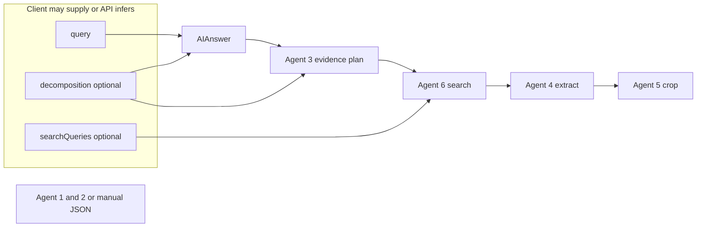
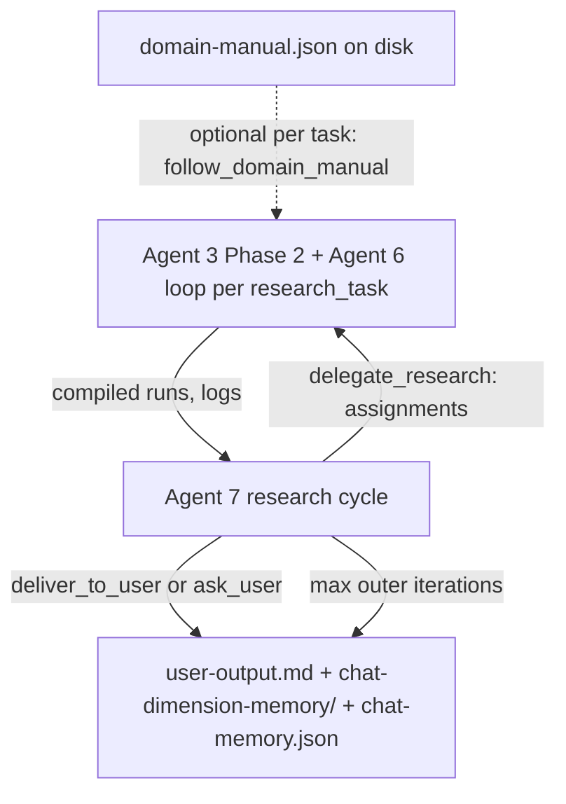

# Summary
Conduct research with AI agents + ability to inject domain knowledge into your workflows. 

_Work in progress._

# Agentic research — architecture

This app runs **two related but separate research stacks** on top of Next.js route handlers and Amazon Bedrock (where noted). They share some names (e.g. “Agent 3”, “Agent 6”) but different code paths and responsibilities.

---

## 1. Two tracks

### A. **Dual-column evidence pipeline** (cynical verification UI)

**Intent:** Turn a user query into an AI draft answer, break it into verifiable segments, find web sources, extract page text, and crop supporting passages—**without** the Agent 7 strategic loop.

**Typical call:** `POST /api/pipeline` (runs the full chain server-side).

**High-level flow:**

1. **Query decomposition (Agent 1)** — optional if you pass a full `decomposition` object. Otherwise produced via `POST /api/decompose` or skipped when the pipeline only has `query`.
2. **AIAnswer** — model-generated `answer_text` + `declared_sources` (`POST /api/ai-answer` is the standalone step; `/api/pipeline` calls the same logic).
3. **Agent 3 (evidence)** — segments the answer into `EvidenceSegment`s and pairs them with a resource plan (`agent3_plan`: segments + which URLs to hit).
4. **Agent 6 (search)** — given segments + optional per-angle `searchQueries`, returns ranked/fetched resources (Parallel search policy applies).
5. **Agent 4 (extract)** — fetches and normalizes page text into an `ExtractBundle` (url → `RetrievedPage`).
6. **Agent 5 (crop)** — produces `CroppedEvidenceItem[]` ordered by flow through the answer.

**Output type:** `PipelineDualColumnResponse` — `core_query`, optional `decomposition`, `ai_answer`, `agent3_plan`, `evidence_items` — see `src/lib/types.ts`.

**Optional request fields (pipeline):** `decomposition`, `searchQueries`, `sourcePolicy` (include/exclude domains, date window), `pipeline_run_id` (echoed back for tracing).

---

### B. **Strategic research (Agent 7 ↔ Agent 3/6 loop)**

**Intent:** A **judging/orchestrating** model (Agent 7) that never does web search itself. It issues **`research_task`** objects; **Agent 3 (Phase 2)** plans, **Agent 6 (Phase 2)** runs Parallel search + structured extraction, in a **loop** until confidence or iteration caps. Domain context comes from a **single workspace file** (not the HTTP body).

**Entry point (Research tab / production):** `POST /api/research-chat`

**High-level flow:**

1. **Agent 7 (research cycle mode)** — reads `objective`, optional **subject scope**, **memory**, **key_findings**, **dimensions**, **known_gaps**, compact **chat history**, and **`domain_manual` from `workspace/domain-manuals/domain-manual.json`**. It outputs:
   - `orchestration`: `delegate_research` | `deliver_to_user` | `ask_user`
   - `assignments` (when delegating) including one or more **`agent3_agent6`** rows with a full `research_task`
   - `findings_summary` (required) for the memory file
   - `user_facing_document` (required when not delegating) — markdown for the user
2. For each **`agent3_agent6`** task, the server runs **`runAgent36ResearchLoop`**: plan → Agent 6 → unified Agent 3 review → repeat up to `max_iterations_3_6` (default 3, hard cap 20), optionally stopping early if **min confidence** is met.
3. **Parallel tasks:** Multiple `agent3_agent6` rows in a single Agent 7 turn run **in parallel** (separate 3/6 loops); results are passed back as separate compiled runs.
4. **Persistence (research mode):** Appends to `workspace/chat-memory.json`, updates `workspace/user-output.md`, syncs `workspace/chat-dimension-memory/*.md`, returns `document_markdown` and step traces to the client.

**Optional `research-chat` body fields:** `subject_scope`, `research_hygiene`, `memory`, `known_gaps_seed`, `key_findings`, `dimensions`, `max_outer_iterations`, `min_confidence`, `max_iterations_3_6`.

**Agent 7 assignment targets (orchestrator vocabulary):** `agent3_agent6`, `agent4_agent5`, `agent8`. The **7↔3/6 research runner only executes `agent3_agent6`**. `agent4_agent5` and `agent8` are **planning hooks** in the model output; they are **not** executed in this loop (see `src/lib/agents/agent7ResearchCycle.ts` system prompt).

---

## 2. Workspace files

| File | Role |
|------|------|
| `workspace/domain-manuals/domain-manual.json` | Single source of truth for **domain** context to Agent 7 and, when `research_task.follow_domain_manual` is not `false`, to Agent 3/6. APIs do **not** accept manual overrides. |
| `workspace/chat-memory.json` | Research turns: ordered blocks with `question`, `user-output` (Agent 7 / 3-6 trace summaries). Source for dimension markdown. |
| `workspace/chat-dimension-memory/*.md` | One file per dimension id (+ `objective-scope.md`): slices derived from `chat-memory.json` (no extra LLM). |
| `workspace/user-output.md` | Latest user-facing markdown from the research session. |
| `workspace/sandbox-73-memory.json` | Optional alternate persistence for the same orchestration loop in **sandbox** mode (not the Research tab default). |
| `workspace/context-bridge.json` | Debug: last Agent 7 `system` + `user` strings sent to the model. |

---

## 3. API routes (cheat sheet)

| Route | Purpose |
|-------|---------|
| `POST /api/decompose` | Agent 1: `{ query }` → `QueryDecomposition` |
| `POST /api/research` | Agent 2: `{ decomposition, yearRange? }` → `SearchQueries` |
| `POST /api/ai-answer` | AIAnswer: `{ query, decomposition? }` → `AIAnswerOutput` |
| `POST /api/pipeline` | Full **dual-column** pipeline → `PipelineDualColumnResponse` |
| `POST /api/parallel-search` | Direct Parallel search (low-level) |
| `POST /api/parallel-extract` | Direct Parallel extract for one URL (low-level) |
| `POST /api/agent3-evidence` | Agent 3 evidence plan only (uses AIAnswer + decomposition) |
| `POST /api/agent3-segments` | Segments only (debug-style) |
| `POST /api/agent4-extract` | Agent 4 bundle build (used inside pipeline) |
| `POST /api/agent5-crop` | Agent 5 crops (used inside pipeline) |
| `POST /api/agent6-search` | Pipeline-style Agent 6 resource fetch |
| `POST /api/agent7-orchestrate` | Agent 7 **non-cycle** orchestration (assignments, no 3/6 loop) — domain manual from file |
| `POST /api/agent3-research-task` / `agent3-research-plan` / `agent3-phase2` / `agent3-6-research-loop` | **Phase 2** Agent 3/6 building blocks and full loop (for tools / debugging) |
| `POST /api/agent6-research-task` | **Phase 2** Agent 6 execution for one `research_task` + optional Agent 3 assignment |
| `POST /api/agent7-3-orchestrate-loop` | Full **outer** 7↔3/6 loop (orchestration entry similar to `research-chat` but different wiring) |
| `POST /api/research-chat` | **Research tab:** one user turn → `runAgent73OrchestrationLoop` + disk persistence |
| `POST /api/research-clear-chat-memory` | Clears `chat-memory.json` and `chat-dimension-memory/*.md` |
| `POST /api/chat` | Simple Bedrock chat (not the agent research stack) |

---

## 4. Environment / models

- **Bedrock:** Used for most LLM steps (see `src/lib/bedrockModel.ts`, `readBedrockEnv` for `/api/chat`).
- **Parallel:** Web search and extract (API keys and policy in env — see `parallelSourcePolicy`, `createParallelClient`).
- **Convex** (optional): user sync, auth; not required for the research routes above.

For setup (Next, Clerk, Convex), use `.env` / `.env.local` and the Convex dashboard as described in your team docs.

---

## 5. Where to go deeper

- **Types:** `src/lib/types.ts` — `QueryDecomposition`, `PipelineDualColumnResponse`, `Agent7ResearchTask`, `Agent6ResearchRunResult`, etc.
- **Agent 7 field reference (short):** `src/lib/agent7SpecCheatsheet.ts`
- **Agent 3/6 Phase 2 reference:** `src/lib/agent36SpecCheatsheet.ts`
- **Verbatim per-agent I/O:** **`README2.md`**

---

## 7. Per-agent inputs and outputs (detailed)

The two tracks in **§1** use different contracts. Below, **required** means needed for a successful run on that code path; **optional** can be omitted or empty where noted.

### 7.1 — Agent 1 (query decomposition)

| | |
|--|--|
| **Role** | Normalize a free-form string into a single investigable `core_query`, `keywords`, and `support_angles` (2+ angles on success). |
| **Main API** | `POST /api/decompose` body: `{ "query": string }` (non-empty). |
| **Inputs (conceptual)** | User query string; no decomposition object is passed in. |
| **Output (`QueryDecomposition`)** | `core_query: string` — one focused line. `keywords: string[]` — non-empty. `support_angles: SupportAngle[]` — each with `id`, `label`, `description` (all non-empty). |
| **Failure cases** | Empty query → 400. Model may return `kind: invalid_input` (handled as `NoValidQueryError`). |
| **Downstream** | Feeds **Agent 2** (`/api/research`), **AIAnswer** (optional), and **`/api/pipeline`** when you supply `decomposition` in the request body. |

---

### 7.2 — Agent 2 (strategic search queries)

| | |
|--|--|
| **Role** | For each `support_angles[].id`, emit `StrategyQueryItem` rows: concrete **search** strings (not excerpts), with `type` + `reasoning`. |
| **Main API** | `POST /api/research` body: `{ "decomposition": QueryDecomposition, "yearRange"?: string }`. |
| **Inputs** | Full **Agent 1** `QueryDecomposition` (2–6 support angles in schema); optional `yearRange` to bias recency. |
| **Output (`SearchQueries`)** | Object keyed by **support angle id** → `StrategyQueryItem[]`. Each item: `type`, `query`, `reasoning` (all required, non-empty). |
| **Validation** | All keys in `searchQueries` must be valid `support_angles` ids if you pass both `decomposition` and `searchQueries` to the pipeline. |
| **Downstream** | Drives **Agent 6 (pipeline)** per-angle when wired through `/api/pipeline` via `searchQueries`. |

---

### 7.3 — AIAnswer (answer draft, not a numbered “Agent” in filenames)

| | |
|--|--|
| **Role** | Produce a first-pass narrative answer and `declared_sources` for the **dual-column** path. |
| **Main API** | `POST /api/ai-answer` body: `{ "query": string, "decomposition"?: { core_query, keywords, support_angles } }`. |
| **Inputs** | **Required:** `query`. **Optional:** `decomposition` — if present, `support_angles` ids must be unique. |
| **Output (`AIAnswerOutput`)** | `answer_text: string` — full draft. `declared_sources: { url, title? }[]` — claimed references (not verified yet). |
| **Downstream** | Required input to **Agent 3 (evidence)** segmentation and the rest of `/api/pipeline`. |

---

### 7.4 — Agent 3 (evidence / dual-column)

| | |
|--|--|
| **Role** (this path) | (1) Split `answer_text` into `EvidenceSegment`s (exact `quote_from_ai_answer` substrings, `verification_challenge` each). (2) Build **`Agent3EvidencePlan`**: same segments + `Agent3ResourceRow[]` (URLs, `segment_ids`, `status`, optional `title` / `angle_id`). |
| **Typical call sites** | Inside `POST /api/pipeline` after AIAnswer: `generateEvidenceSegments` then `generateAgent6Resources` (Agent 6) then `composeAgent3EvidencePlan`. |
| **Inputs** | `AIAnswerOutput` + `QueryDecomposition` (optional in some code paths) + later **`Agent3ResourceRow[]`** from Agent 6 to compose the final plan. |
| **Key output pieces** | `EvidenceSegment`: `segment_id`, `quote_from_ai_answer`, `intent?`, `verification_challenge`. `Agent3EvidencePlan`: `evidence_segments` + `resources`. |
| **Note** | This is **not** the same as **Agent 3 Phase 2** (research); same number, different module (`agent3Segments` / `agent3Evidence` vs `agent3Phase2`). |

---

### 7.5 — Agent 6 (search / pipeline)

| | |
|--|--|
| **Role** | `Parallel` **`beta.search`** (one shot per internal batch), driven by each segment’s `verification_challenge` + quote slice + optional **Agent 2** strategy queries. |
| **Inputs** | `AIAnswerOutput` (must have `answer_text`), non-empty `EvidenceSegment[]`, optional `QueryDecomposition`, optional `SearchQueries` keyed by angle id, optional merged **source policy** (domains, dates). |
| **Output** | `Agent3ResourceRow[]` — deduplicated by URL; `segment_ids` list which claim spans the URL is meant to support; `status` typically `ok` / fetch states. |
| **Implementation** | `src/lib/agents/agent6Search.ts` → `generateAgent6Resources`. |

---

### 7.6 — Agent 4 (extract / pipeline)

| | |
|--|--|
| **Role** | For URLs in the plan, fetch or extract **full-ish page text** and normalize to **`RetrievedPage`** (plus optional author/publication/year when available). |
| **Inputs** | `AIAnswerOutput` + `Agent3EvidencePlan` (segments + which URLs) — `buildExtractBundle` resolves URLs and uses Parallel extract. |
| **Output (`ExtractBundle`)** | Map **normalized url string → `RetrievedPage`**: `cleanText`, `httpStatus`, optional metadata, `extract_error?` if failed. |
| **Implementation** | `src/lib/agents/agent4Extract.ts` (`buildExtractBundle`). |

---

### 7.7 — Agent 5 (crop / pipeline)

| | |
|--|--|
| **Role** | With bundle text, select **flow-aligned** supporting crops: substring-safe `cropped_text` per segment, ordered by `flow_index` in the answer. |
| **Inputs** | `AIAnswerOutput` + `Agent3EvidencePlan` + non-empty `ExtractBundle` (or empty → no items). |
| **Output** | `CroppedEvidenceItem[]` — `flow_index`, `segment_ids`, `url`, `cropped_text`, optional `location_hint`, author, publication, year. |
| **Final HTTP shape** | Rolled into **`PipelineDualColumnResponse`**: `core_query`, optional `decomposition`, `ai_answer`, `agent3_plan`, `evidence_items`, optional `pipeline_run_id`. |

---

### 7.8 — Agent 7 (orchestrator / research)

**Two call shapes:**

#### (a) One-shot orchestration — `POST /api/agent7-orchestrate`

| **Inputs (JSON body)** | `objective` (required, non-empty). **Optional:** `research_hygiene` (object), `memory` (object), `known_gaps_seed` (array of `{ dimension?, gaps[] }`), `key_findings` (object), `dimensions` (1–16 of `{ label, description? }`). **Not in body:** `domain_manual` — read from `workspace/domain-manuals/domain-manual.json`. |
| **Output (model, `Agent7OrchestrateResult` family)** | `objective_understanding`, `dimensions[]`, `key_findings` (object), `known_gaps[]`, `confidence` `{ level, rationale? }`, `train_of_thought`, `assignments[]` (each with `assignee` ∈ `agent3_agent6` \| `agent4_agent5` \| `agent8`, optional `summary`, and task-specific fields — see 7.12). **No 3/6 loop** is run server-side in this route. |

#### (b) Research cycle — `POST /api/research-chat` and inner `orchestrateAgent7ResearchCycle`

| **Inputs (prompt-side)** | `objective` (user `message`); **optional** `subject_scope` (entity / out-of-scope / disambiguation budget), `research_hygiene`, `memory`, `key_findings`, `dimensions`, `known_gaps` seed, compact `chat_memory` + **`last_compiled_runs`**, `domain_manual` (file), `outer_iteration` + **`inner_loop`** caps (`min_confidence`, `max_iterations`). |
| **Output (structured)** | `orchestration`: **`delegate_research`** \| **`deliver_to_user`** \| **`ask_user`**. **`findings_summary`** (required): `{ key: string, value: unknown }` for the head of `chat-memory.json`. **`user_facing_document`**: required when *not* delegating — full markdown report or short clarify questions. **`assignments`**: if `delegate_research`, at least one **`agent3_agent6`** with full **`research_task`**. **Research runner executes only `agent3_agent6`**; `agent4_agent5` / `agent8` rows are model output, not separate executors in this loop. |

---

### 7.9 — `research_task` (passed from Agent 7 to 3/6; not a network “agent” by itself)

| | |
|--|--|
| **Required on path** | `task_id`, `dimension`, `factor`, `goal`, `priority` ∈ `high` \| `medium` \| `low`. |
| **Common optional** | `context` (object), `method_instructions[]`, `variables_to_find[]`, `calculation_logic`, `search_guidance[]`, `validation_criteria[]`, `adaptation_signals[]`, `fallback_methods[]`, `success_criteria[]`, `expected_output_format[]`, **`follow_domain_manual`** (boolean: **`false`** = do not pass workspace domain manual to 3/6; omit or `true` = use file). |
| **Used by** | `runAgent36ResearchLoop`, `runAgent6ResearchTask`, `generateAgent3Phase2`. |

---

### 7.10 — Agent 3 (Phase 2 / research)

| | |
|--|--|
| **Role** | After Agent 7 assigns a `research_task`, plans **`agent6_assignment`** (`search_objective`, `search_queries[]`, `extraction_notes?`); after Agent 6 returns, **reviews** in one structured response: sources, analysis, `research_log` row material (`scan`, `decision`, `insight`, `progress_metrics`, `entity_tracking`, confidence breakdown, etc.). |
| **Core inputs** | `research_task: Agent7ResearchTask`; **optional** `domain_manual` (object or omitted when `follow_domain_manual` is false), `research_hygiene`, `agent6_result` (if absent → **plan-only** branch), `research_log[]` (iteration memory), `iteration_hint`. |
| **Plan output (subset)** | `plan_summary`, `search_objective`, `search_queries` (distinct list, bounded length in schema), `extraction_notes?`, `open_questions?` — these drive **Agent 6 Phase 2**. |
| **Full / review output (subset)** | `sources_and_data[]`, `analysis_points[]`, `summary`, `task_gaps[]`, `assumptions[]`, `confidence` (numeric score + breakdown + `reasoning[]`), `progress_metrics`, `entity_tracking`, `scan` (observations, patterns), `decision` (`needs_further_search`, `reason`, optional next queries), `insight`, duplicate convenience `needs_further_search` / `suggested_queries` when present. |
| **Loop aggregate** | `POST /api/agent3-6-research-loop` returns **`Agent36ResearchLoopResponse`**: `final_agent3_result`, `agent3_plans[]`, `agent6_runs[]`, `iteration_trace[]`, `research_log[]`, `iterations`, `stopped_reason` (`sufficient` \| `max_iterations` \| `min_confidence`). |

---

### 7.11 — Agent 6 (Phase 2 / research)

| | |
|--|--|
| **Role** | `Parallel` **`beta.search`** using Agent 3’s objective + query list (or legacy fallback from `research_task` only), then LLM **structured** **`extracted_key_data`** (entities, bullets, `status`, `source_url` ties, quality signals) over returned excerpts. |
| **Main inputs** | `research_task` (required, validated to schema). **Optional:** `domain_manual` / `research_hygiene` (when not opted out), **`agent3_assignment`** (normal path: copies search objective, queries, extraction notes from Agent 3 plan), `iteration_extension` (`additional_queries[]`, `objective_suffix` for a round). |
| **Output (`Agent6ResearchRunResult`)** | `queries_used: string[]`, `source_urls: string[]`, `extracted_key_data: ExtractedKeyDatum[]` (per-row entity-style facts, evidence snippets, `status` `found` \| `partial` \| `not_found`, etc.), `parallel_search_id?`. |
| **Downstream** | Fed back as **`agent6_result`** into the next `generateAgent3Phase2` call; appended in **`agent6_runs`** in the 3-6 loop response. |

---

### 7.12 — Agent 7 assignment rows (`agent4_agent5`, `agent8`) in research cycle

| **Assignee** | **Intended I/O in the schema** | **What the research runner does** |
|-------------|--------------------------------|-------------------------------------|
| `agent3_agent6` | `research_task` (required) + optional `summary` | **Executed:** inner 3/6 loop as above. |
| `agent4_agent5` | `verbatim_brief?`, `summary?` (verbatim extract + crop brief) | **Not executed** in the 7↔3/6 research loop — planner / future use only. |
| `agent8` | `memory_directive?` (how to merge session memory) | **Not executed** as a separate agent here — file persistence and `findings_summary` are handled by the server and Agent 7’s structured output. |

---

### 7.13 — `POST /api/research-chat` request and response (end-to-end)

| **Request (body, principal fields)** | `message` (required) — user turn. **Optional:** `subject_scope`, `research_hygiene`, `memory`, `known_gaps_seed`, `key_findings`, `dimensions`, `max_outer_iterations` (1–50, default 5), `min_confidence` (0–1, inner 3/6), `max_iterations_3_6` (1–20, default 3). |
| **Response (success, principal fields)** | `document_markdown` — what to show; `stopped` — how the loop ended; `key_findings`, `dimensions`, `known_gaps` — echo for the **next** client call; `steps` — trace (`agent7` / `agent36` / `finalize`); `chat_memory_path`, `user_output_path` — workspace files written. **502** on model/runtime failures with `error` string. |
