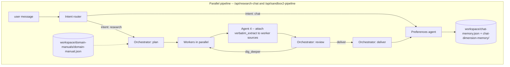

# Agentic Research

Conduct research with AI agents and inject domain knowledge into the workflow.

*Work in progress.*

The codebase lives under `src/` (Next.js app, route handlers, agents). Backend persistence is the local `workspace/` directory (no DB).

---

## Contents

1. [Architecture](#1-architecture)
2. [Production pipeline](#2-production-pipeline-runparallelpipeline)
3. [Workspace files](#3-workspace-files)
4. [API routes — cheat sheet](#4-api-routes--cheat-sheet)
5. [API routes — request / response detail](#5-api-routes--request--response-detail)
6. [Agent entry points (TypeScript)](#6-agent-entry-points-typescript)
7. [Key types](#7-key-types)
8. [Defaults, caps, status codes](#8-defaults-caps-status-codes)
9. [Environment / models](#9-environment--models)

---

## 1. Architecture

The entire research stack centers on `runParallelPipeline`: intent router → orchestrator plan → parallel research workers → orchestrator review (looped) → orchestrator deliver → preferences agent. Workers' source URLs are post-processed through Agent 4 (`enrichWorkerOutputWithAgent4Extract`) to attach verbatim page text per source.



---

## 2. Production pipeline (`runParallelPipeline`)

**Entry points:** `POST /api/research-chat`, `POST /api/sandbox2-pipeline`. The Research and Demo tabs both go through `/api/research-chat`.

**Steps (`ParallelPipelineStep` kinds):**

1. `intent` — `classifyIntent(message)`. Heuristic first (greetings, short meta-questions, research signals, preference signals), Bedrock LLM fallback. May short-circuit to a chat reply (`stopped: "chat_reply"`) or hand off directly to the preferences agent when `has_preference_signal` is true.
2. `orchestrator_plan` — `orchestratorPlan(...)`. Reads `workspace/domain-manuals/domain-manual.json`, prior memory, prior key findings, dimensions, and gaps. Produces an investment-thesis draft, dimensions, 3–8 tasks, and an `execution_strategy` (`all_parallel` or `two_phase`). System prompt is loaded from `workspace/orchestrator-state/system-prompt.md`.
3. `worker` (×N per round) — `runResearchWorker(task)` runs each task through Parallel `beta.search` + Bedrock extraction LLM. Results are immediately enriched by `enrichWorkerOutputWithAgent4Extract` (Agent 4) which attaches a cleaned `verbatim_extract` (≤ 16 000 chars) to every `WorkerSourceRow`.
4. `orchestrator_review` (×rounds) — coverage assessment + `decision`: `dig_deeper` (with new tasks for the next round) or `deliver`. Bounded by `max_rounds` (default 5).
5. `orchestrator_deliver` — final Markdown report + key findings + dimensions + known gaps + `findings_summary` + `investment_thesis`.
6. `preferences` — `runPreferencesAgent` when the intent flagged a preference signal. Returns a scope (`session` | `conditional_global` | `global`), a user-facing notification, and either a `domain_manual_patch` (persisted to disk) or a `session_preference` (returned to the client).

**Persistence (research-chat only):** `workspace/chat-memory.json` (turn block) and `workspace/chat-dimension-memory/*.md` (per-dimension slices). `sandbox2-pipeline` runs the same code but does not persist.

---

## 3. Workspace files

| Path                                              | Role                                                                                                                                                                       |
| ------------------------------------------------- | -------------------------------------------------------------------------------------------------------------------------------------------------------------------------- |
| `workspace/domain-manuals/domain-manual.json`     | Single source of truth for domain context. Read by the orchestrator, research workers, and the preferences agent. Patched (additive) by the preferences agent. APIs do **not** accept manual overrides in the request body. |
| `workspace/orchestrator-state/system-prompt.md`   | Orchestrator system prompt, loaded at runtime. Required — the orchestrator throws if this file is missing or empty.                                                        |
| `workspace/chat-memory.json`                      | Research turns from `/api/research-chat`: ordered blocks with `question`, `user-output` (parallel-pipeline trace summaries). Source for dimension slices.                  |
| `workspace/chat-dimension-memory/*.md`            | One file per dimension id (+ `objective-scope.md`): markdown slices derived from `chat-memory.json` (no extra LLM call).                                                  |
| `workspace/user-output.md`                        | Latest user-facing markdown from the most recent research turn.                                                                                                            |
| `workspace/context-bridge.json`                   | Debug: last system + user strings sent to the orchestrator.                                                                                                                |
| `workspace/temp-chat-history/<uuid>.json`         | Per-chat draft state for the Demo sidebar (`/api/temp-chat-history`).                                                                                                      |

---

## 4. API routes — cheat sheet

| Route                                  | Purpose                                                                                           |
| -------------------------------------- | ------------------------------------------------------------------------------------------------- |
| `POST /api/research-chat`              | One user turn → `runParallelPipeline` → persist to `chat-memory.json` + `chat-dimension-memory/`. |
| `POST /api/research-clear-chat-memory` | Empty `chat-memory.json` and delete dimension markdowns.                                          |
| `POST /api/sandbox2-pipeline`          | Same `runParallelPipeline`, no persistence.                                                       |
| `POST /api/sandbox2-intent`            | Single intent classification step.                                                                |
| `POST /api/sandbox2-orchestrator`      | Single orchestrator phase: `plan` \| `review` \| `deliver`.                                      |
| `POST /api/sandbox2-worker`            | Single worker run on one task.                                                                    |
| `GET  /api/temp-chat-history`          | List saved demo-tab chat drafts.                                                                  |
| `POST /api/temp-chat-history`          | Upsert a demo-tab chat draft.                                                                     |
| `POST /api/chat`                       | Simple Bedrock chat (not the agent stack).                                                        |

---

## 5. API routes — request / response detail

All request bodies are Zod-validated. Unknown fields are rejected. **Required** = must be present and non-empty/non-zero where applicable; **Optional** = may be omitted entirely.

### 5.1 `POST /api/research-chat`

**Source:** `src/app/api/research-chat/route.ts`

**Request body**

| Field                 | Required? | Type / notes                                                                                                                        |
| --------------------- | --------- | ----------------------------------------------------------------------------------------------------------------------------------- |
| `message`             | **yes**   | `string` (min 1) — user turn                                                                                                        |
| `subject_scope`       | optional  | `string` (≤ 12 000 chars) — entity / out-of-scope / disambiguation budget                                                           |
| `research_hygiene`    | optional  | `Record<string, unknown>` — citation / process constraints                                                                          |
| `memory`              | optional  | `Record<string, unknown>` — durable prior-turn facts                                                                                |
| `known_gaps_seed`     | optional  | `Agent7KnownGapGroup[]`                                                                                                             |
| `key_findings`        | optional  | `Record<string, unknown>`                                                                                                           |
| `dimensions`          | optional  | `Agent7Dimension[]` (1–16); ids are normalized via `normalizeDimensionId`                                                           |
| `session_preferences` | optional  | `SessionPreference[]`                                                                                                               |
| `pipeline_config`     | optional  | Partial `PipelineConfig` (see §7); all fields individually clamped                                                                  |
| `sourcePolicy`        | optional  | `{ excludeDomains?, includeDomains?, afterDate?, beforeDate? }` — domain lists clamped to `PARALLEL_SOURCE_POLICY_MAX_DOMAINS` (10) |

> **Backward-compat fields** still accepted but ignored by the parallel pipeline: `max_outer_iterations`, `min_confidence`, `max_iterations_3_6`.

**Response — 200 success**

| Field                      | Type                                           |
| -------------------------- | ---------------------------------------------- |
| `document_markdown`        | `string`                                       |
| `stopped`                  | `"user_deliver" \| "ask_user" \| "chat_reply"` |
| `key_findings`             | `Record<string, unknown>`                      |
| `dimensions`               | `Agent7Dimension[]`                            |
| `known_gaps`               | `Agent7KnownGapGroup[]`                        |
| `steps`                    | `ParallelPipelineStep[]`                       |
| `chat_memory_path`         | `string` (workspace-relative)                  |
| `user_output_path`         | `string` (workspace-relative)                  |
| `preference_notification?` | `string`                                       |
| `session_preferences?`     | `SessionPreference[]`                          |

Note: `rounds_completed` is present on the `ParallelPipelineResult` type but is not forwarded in the HTTP response body of this route.

**Response — 502 error**: `{ error: string, steps?: ParallelPipelineStep[] }`

---

### 5.2 `POST /api/research-clear-chat-memory`

**Request:** no body. **Response — 200:** `{ ok: true, path: "workspace/chat-memory.json" }`. **Response — 500:** `{ error: string }`. Side effect: writes `{}` to `chat-memory.json` and deletes every file in `workspace/chat-dimension-memory/`.

---

### 5.3 `POST /api/sandbox2-pipeline`

Same pipeline as `/api/research-chat` but **without** workspace persistence (no `chat_memory_path` / `user_output_path` writes). Useful for headless or sandbox runs.

**Request body**

| Field              | Required? | Notes                    |
| ------------------ | --------- | ------------------------ |
| `objective`        | **yes**   | user message / objective |
| `subject_scope`    | optional  | ≤ 12 000 chars           |
| `research_hygiene` | optional  |                          |
| `pipeline_config`  | optional  | partial `PipelineConfig` |

**Response:** `ParallelPipelineResult` (200 on `success: true`, 502 on `success: false`).

---

### 5.4 `POST /api/sandbox2-intent`

| Field                  | Required? |
| ---------------------- | --------- |
| `message`              | **yes**   |
| `conversation_context` | optional  |

**Response — 200** (`IntentClassification`):

```ts
{
  intent: "chat" | "research";
  has_preference_signal: boolean;
  reasoning: string;
  chat_reply?: string; // populated when intent === "chat"
}
```

**Response — 502** on LLM failure.

---

### 5.5 `POST /api/sandbox2-orchestrator`

Single-step orchestrator endpoint; pick the phase explicitly.

| Field                      | Required?   | Notes                                                       |
| -------------------------- | ----------- | ----------------------------------------------------------- |
| `phase`                    | **yes**     | `"plan" \| "review" \| "deliver"`                           |
| `objective`                | **yes**     |                                                             |
| `subject_scope`            | optional    | ≤ 12 000 chars                                              |
| `conversation_context`     | optional    |                                                             |
| `user_preferences_summary` | optional    | auto-loaded from domain manual if omitted                   |
| `research_hygiene`         | optional    |                                                             |
| `prior_key_findings`       | optional    |                                                             |
| `prior_dimensions`         | optional    | `Agent7Dimension[]`                                         |
| `prior_known_gaps`         | optional    | `Agent7KnownGapGroup[]`                                     |
| `plan`                     | conditional | **required** for `phase: "review"` and `phase: "deliver"`   |
| `all_worker_results`       | conditional | **required** for `phase: "review"` and `phase: "deliver"`   |
| `prior_review`             | optional    | continuation context for `phase: "review"`                  |
| `final_review`             | conditional | **required** for `phase: "deliver"`                         |
| `round`                    | optional    | int 1–5 (defaults to 1 for review)                          |
| `max_rounds`               | optional    | int 1–5 (defaults to 3 for review)                          |
| `rounds_completed`         | optional    | int ≥ 1, for `phase: "deliver"`                             |

**Response per phase** — `OrchestratorPlanOutput`, `OrchestratorReviewOutput`, or `OrchestratorDeliverOutput` (see §7). **400** if required-per-phase fields are missing; **502** on LLM errors.

---

### 5.6 `POST /api/sandbox2-worker`

| Field                      | Required? | Notes                                        |
| -------------------------- | --------- | -------------------------------------------- |
| `task`                     | **yes**   | `PlannerResearchTask`                        |
| `domain_manual`            | optional  | full domain manual object                    |
| `research_hygiene`         | optional  |                                              |
| `user_preferences_summary` | optional  |                                              |
| `profile_context`          | optional  | string from a prior profile task (two_phase) |

**Response — 200** (`WorkerOutput`):

```ts
{
  task_id: string;
  dimension: string;
  factor: string;
  summary: string;                       // 200–500 words
  sources: WorkerSourceRow[];            // { url, title?, relevance, data_noted, verbatim_extract? }
  extracted_data: ExtractedKeyDatum[];
  confidence: number;                    // 0–1
  gaps_remaining: string[];
  search_queries_used: string[];
  rabbithole_leads?: string[];           // 0–5
}
```

**Response — 502** on worker failure.

---

### 5.7 `GET /api/temp-chat-history`

No body. **Response — 200:** `{ items: TempChatHistoryListItemV1[] }` sorted by mtime descending — each `{ id: string, title: string, savedAt: string (ISO 8601) }`. Empty `items[]` if the directory does not exist.

### 5.8 `POST /api/temp-chat-history`

| Field    | Required? | Notes                                                                                                                    |
| -------- | --------- | ------------------------------------------------------------------------------------------------------------------------ |
| `chatId` | **yes**   | UUID (`isTempChatHistoryId()` enforced)                                                                                  |
| `state`  | **yes**   | `TempChatHistoryFileV1` state (messages, draft, all composer text fields, seeds, session prefs, pipeline config strings) |

**Response — 200:** `{ id, savedAt, title }`. **400** on invalid UUID or empty `messages`. Writes `workspace/temp-chat-history/<chatId>.json`.

---

### 5.9 `POST /api/chat`

| Field      | Required? | Notes                                                                                                          |
| ---------- | --------- | -------------------------------------------------------------------------------------------------------------- |
| `messages` | **yes**   | `Array<{ role: "user" \| "assistant", text: string }>` (min 1); **first** and **last** must have `role: "user"` |

**Response — 200:** `{ reply: string }`. **503** if Bedrock env vars missing (`AWS_REGION`, `AWS_ACCESS_KEY_ID`, `AWS_SECRET_ACCESS_KEY`, `BEDROCK_MODEL_ID`). **400** on validation. **502** on Bedrock failure.

---

## 6. Agent entry points (TypeScript)

All under `src/lib/agents/`.

### 6.1 `runParallelPipeline` (`runParallelPipeline.ts`)

```ts
type RunParallelPipelineInput = {
  objective: string;
  subject_scope?: string;
  research_hygiene?: Record<string, unknown>;
  memoryJson?: Record<string, unknown>;
  known_gaps_seed?: Agent7KnownGapGroup[];
  key_findings?: Record<string, unknown>;
  dimensions?: Agent7Dimension[];
  session_preferences?: SessionPreference[];
  pipeline_config?: Partial<PipelineConfig>;
  source_policy_request?: ParallelSourcePolicyRequest;
};

type ParallelPipelineResult =
  | {
      success: true;
      stopped: "user_deliver" | "ask_user" | "chat_reply";
      document_markdown: string;
      key_findings: Record<string, unknown>;
      dimensions: Agent7Dimension[];
      known_gaps: Agent7KnownGapGroup[];
      chat_memory_path: string;
      user_output_path: string;
      preference_notification?: string;
      session_preferences?: SessionPreference[];
      rounds_completed: number;
      steps: ParallelPipelineStep[];
    }
  | { success: false; error: string; steps?: ParallelPipelineStep[] };
```

### 6.2 `classifyIntent` (`intentRouter.ts`)

`async classifyIntent(message: string, conversation_context?: string): Promise<IntentClassification>`. Heuristics first; Bedrock LLM fallback. Auto-fills `chat_reply` when `intent === "chat"`.

### 6.3 Orchestrator (`orchestrator.ts`)

Loads the system prompt from `workspace/orchestrator-state/system-prompt.md` on every call.

- `orchestratorPlan({ objective, subject_scope?, domain_manual, conversation_context, user_preferences_summary, research_hygiene?, prior_key_findings?, prior_dimensions?, prior_known_gaps?, config }) → OrchestratorPlanOutput`
- `orchestratorReview({ objective, subject_scope?, user_preferences_summary, plan, all_worker_results, round, max_rounds, prior_review?, config }) → OrchestratorReviewOutput`
- `orchestratorDeliver({ objective, subject_scope?, user_preferences_summary, plan, all_worker_results, final_review, rounds_completed, config }) → OrchestratorDeliverOutput`

### 6.4 `runResearchWorker` / `runWorkersParallel` (`researchWorker.ts`)

`async runResearchWorker({ task, domain_manual?, research_hygiene?, user_preferences_summary, profile_context? }): Promise<WorkerOutput>`. `runWorkersParallel` fans these out with a stagger of `worker_stagger_ms` between starts. Passes the `search_source_policy` to each worker's Parallel `beta.search` call.

### 6.5 `enrichWorkerOutputWithAgent4Extract` (`agent4Extract.ts`)

`async enrichWorkerOutputWithAgent4Extract(output: WorkerOutput): Promise<WorkerOutput>`. Calls Parallel `beta.extract` over deduped source URLs and attaches a cleaned `verbatim_extract` (≤ 16 000 chars) to each `WorkerSourceRow`. Non-fatal: errors or a missing API key leave `verbatim_extract` undefined.

### 6.6 `runPreferencesAgent` (`preferencesAgent.ts`)

```ts
runPreferencesAgent({
  user_message: string;
  conversation_context: string;
  current_preferences: DomainManualUserPreferences;
  objective_context: string;
}) → Promise<PreferencesAgentOutput>
```

Classifies a preference signal into `session`, `conditional_global`, or `global`. Returns a notification and either a `domain_manual_patch` (persisted to `domain-manual.json` via `applyPreferencePatch`) or a `session_preference` (echoed back to the client only).

---

## 7. Key types

`src/lib/types.ts` is the canonical source. `src/lib/agents/dimensionSchemas.ts` exports the Zod schemas (`researchDimensionSchema`, `knownGapGroupSchema`) used at API boundaries.

> **Legacy name note:** `Agent7Dimension` and `Agent7KnownGapGroup` retain the `Agent7` prefix for historical reasons but are the live dimension/gap types used throughout the current orchestrator pipeline — they are not specific to any legacy agent.

### Pipeline config

```ts
interface PipelineConfig {
  max_rounds: number;
  max_workers_concurrent: number;
  worker_stagger_ms: number;
  max_worker_steps: number;
  max_tasks_per_round: number;
  orchestrator_temperature: number;
  worker_temperature: number;
  deliver_max_tokens: number;
}

const DEFAULT_PIPELINE_CONFIG: PipelineConfig = {
  max_rounds: 5,
  max_workers_concurrent: 2,
  worker_stagger_ms: 2000,
  max_worker_steps: 5,
  max_tasks_per_round: 8,
  orchestrator_temperature: 0.2,
  worker_temperature: 0.2,
  deliver_max_tokens: 16_000,
};

type ParallelPipelineStep =
  | { kind: "intent"; result: IntentClassification }
  | { kind: "orchestrator_plan"; result: OrchestratorPlanOutput }
  | { kind: "worker"; task_id: string; round: number; result: WorkerOutput }
  | { kind: "orchestrator_review"; round: number; result: OrchestratorReviewOutput }
  | { kind: "orchestrator_deliver"; result: OrchestratorDeliverOutput }
  | { kind: "preferences"; result: PreferencesAgentOutput };
```

### Intent

```ts
type IntentClassification = {
  intent: "chat" | "research";
  has_preference_signal: boolean;
  reasoning: string;
  chat_reply?: string;
};
```

### Orchestrator outputs

```ts
interface OrchestratorPlanOutput {
  objective_understanding: string;
  investment_thesis_draft: string;
  dimensions: Agent7Dimension[];
  known_gaps: Agent7KnownGapGroup[];
  tasks: PlannerResearchTask[];                        // 3–8
  execution_strategy: "all_parallel" | "two_phase";
  profile_task_id?: string;
  working_notes: string;
}

interface OrchestratorReviewOutput {
  working_notes: string;
  key_findings: Record<string, unknown>;
  coverage_assessment: CoverageAssessment[];
  dimensions: Agent7Dimension[];
  known_gaps: Agent7KnownGapGroup[];
  contradictions: string[];
  connections: string[];
  decision:
    | { action: "dig_deeper"; tasks: PlannerResearchTask[] }
    | { action: "deliver" };
}

interface OrchestratorDeliverOutput {
  user_facing_document: string;
  key_findings: Record<string, unknown>;
  dimensions: Agent7Dimension[];
  known_gaps: Agent7KnownGapGroup[];
  findings_summary: { key: string; value: unknown };
  investment_thesis: string;
}
```

### Dimensions and gaps (shared)

```ts
// NOTE: "Agent7" prefix is a legacy name — these types are used by the current orchestrator pipeline.
interface Agent7Dimension {
  id: string;          // stable slug — must match research_task.dimension
  label: string;
  description?: string;
}

interface Agent7KnownGapGroup {
  dimension?: string;  // must be a dimension id when set
  gaps: string[];
}
```

### Research task / worker output

```ts
interface PlannerResearchTask {
  task_id: string;
  dimension: string;
  factor: string;
  goal: string;
  context?: Record<string, unknown>;
  search_guidance: string[];
  variables_to_find?: string[];
  extraction_focus?: string;
  priority: "high" | "medium" | "low";
  follow_domain_manual?: boolean;
}

interface WorkerSourceRow {
  url: string;
  title?: string;
  relevance: string;
  data_noted: string;
  verbatim_extract?: string;  // attached by Agent 4 post-worker
}

interface WorkerOutput {
  task_id: string;
  dimension: string;
  factor: string;
  summary: string;
  sources: WorkerSourceRow[];
  extracted_data: ExtractedKeyDatum[];
  confidence: number;          // 0–1
  gaps_remaining: string[];
  search_queries_used: string[];
  rabbithole_leads?: string[];
}
```

### Agent 4 extract

```ts
interface RetrievedPage {
  url: string;
  author?: string | null;
  publication?: string | null;
  year?: number | null;
  cleanText: string;
  httpStatus: number;
  extract_error?: string;
}

type ExtractBundle = Record<string, RetrievedPage>; // key = normalized URL string
```

### Extracted key datum

```ts
type Agent6ExtractSignalLevel = "high" | "medium" | "low";

interface ExtractedKeyDatum {
  entity: string;
  type?: string;
  what_it_does: string[];
  how_it_works?: string[];
  target_users?: string[];
  use_cases?: string[];
  differentiation_signals?: string[];
  key_features?: string[];
  evidence_snippets?: string[];
  signals?: {
    novelty?: Agent6ExtractSignalLevel;
    specificity?: Agent6ExtractSignalLevel;
    clarity?: Agent6ExtractSignalLevel;
  };
  status: "found" | "partial" | "not_found";
  source_url?: string;
}
```

### Preferences

```ts
type PreferenceScope = "session" | "conditional_global" | "global";

interface UserPreference {
  id: string;
  rule: string;
  source: string;
  added: string;
  context_when_stated: string;
}

interface ConditionalPreference extends UserPreference { condition: string; }
interface SessionPreference { rule: string; source: string; added: string; }

interface PendingPromotion {
  pattern: string;
  occurrences: { date: string; context: string }[];
  times_seen: number;
  promote_threshold: number;
  candidate_rule: string;
  candidate_scope: "conditional_global" | "global";
}

interface DomainManualUserPreferences {
  global: UserPreference[];
  conditional: ConditionalPreference[];
  pending_promotions: PendingPromotion[];
}

interface PreferencesAgentOutput {
  scope: PreferenceScope;
  notification: string;
  domain_manual_patch?: {
    add_global?: UserPreference[];
    add_conditional?: ConditionalPreference[];
    add_pending_promotion?: PendingPromotion[];
    promote_pending?: string[];
  };
  session_preference?: SessionPreference;
}
```

---

## 8. Defaults, caps, status codes

### Pipeline config defaults

| Setting                                    | Default | Range        | Where                     |
| ------------------------------------------ | ------- | ------------ | ------------------------- |
| `pipeline_config.max_rounds`               | 5       | 1–5          | `DEFAULT_PIPELINE_CONFIG` |
| `pipeline_config.max_workers_concurrent`   | 2       | 1–6          | same                      |
| `pipeline_config.worker_stagger_ms`        | 2000    | 0–10 000     | same                      |
| `pipeline_config.max_worker_steps`         | 5       | 1–10         | same                      |
| `pipeline_config.max_tasks_per_round`      | 8       | 1–12         | same                      |
| `pipeline_config.orchestrator_temperature` | 0.2     | 0–1          | same                      |
| `pipeline_config.worker_temperature`       | 0.2     | 0–1          | same                      |
| `pipeline_config.deliver_max_tokens`       | 16 000  | 4 000–32 000 | same                      |
| `PARALLEL_SOURCE_POLICY_MAX_DOMAINS`       | 10      | n/a          | `parallelSourcePolicy.ts` |
| `VERBATIM_EXTRACT_MAX_CHARS`               | 16 000  | n/a          | `agent4Extract.ts`        |

### Status codes

| Code    | Meaning                                                                                         |
| ------- | ----------------------------------------------------------------------------------------------- |
| **200** | Success (every route)                                                                           |
| **400** | Validation failure (Zod, UUID, missing per-phase fields, empty messages)                        |
| **502** | LLM / orchestration error (Bedrock failures, non-config Parallel errors, pipeline step errors)  |
| **503** | Configuration error (Bedrock env vars missing, `PARALLEL_API_KEY` missing)                      |
| **500** | Workspace I/O errors (`/api/research-clear-chat-memory` only)                                   |

### Domain manual loading

- All pipeline paths read `workspace/domain-manuals/domain-manual.json` from disk; **no API accepts a domain-manual override in the request body**.
- `task.follow_domain_manual === false` skips domain manual injection for that specific research task. Omitted or `true` loads it.
- The preferences agent's `domain_manual_patch` mutates this same file (additive merge via `applyPreferencePatch`).

---

## 9. Environment / models

- **Bedrock** — all LLM calls. Env vars: `AWS_REGION`, `AWS_ACCESS_KEY_ID`, `AWS_SECRET_ACCESS_KEY`, `BEDROCK_MODEL_ID`. See `src/lib/bedrockModel.ts` and `src/lib/bedrockChat.ts`.
- **Parallel** — web search (`beta.search`) and page extract (`beta.extract`) for research workers and Agent 4. Env: `PARALLEL_API_KEY` (required for workers; Agent 4 is non-fatal without it). Source-policy env defaults: `PARALLEL_SEARCH_EXCLUDE_DOMAINS`, `PARALLEL_SEARCH_INCLUDE_DOMAINS`, `PARALLEL_SEARCH_AFTER_DATE`, `PARALLEL_SEARCH_BEFORE_DATE`. See `src/lib/parallelClient.ts`, `src/lib/parallelSourcePolicy.ts`.
- **Convex** (optional) — user sync / auth. Not required for the research routes.

Local setup uses `.env` / `.env.local` and (optionally) the Convex dashboard.
